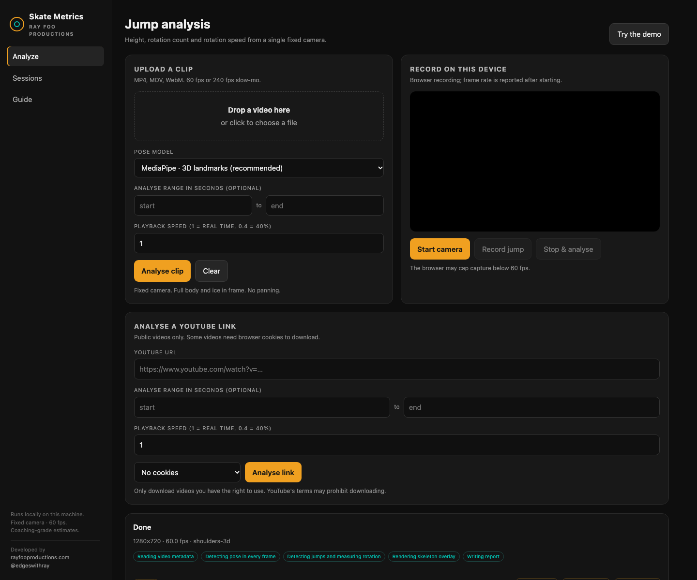

# Skate Metrics

**Developed by [Ray Foo Productions](https://www.rayfooproductions.com) · [@edgeswithray](https://www.instagram.com/edgeswithray/)**

[](https://github.com/rayfoolshs/skate-metrics/actions/workflows/tests.yml)

Markerless figure-skating jump analysis from a single phone video.

The first milestone is an **offline analysis core**: give it a clip, get the
airborne window, jump height, rotation count and rotation speed, plus a skeleton
overlay and an HTML report.

Built for a 60 fps iPhone + iPad capture workflow. Height comes from flight time
(`h = g·t²/8`), so it does not need camera calibration. Rotation comes from the
shoulder line (hips as fallback), unwrapped across the jump.

> Status: v0.1.0 — offline core, local web app, synthetic demo. The native iOS
> capture app and iPad coach view are the next milestones.



## Documentation

- [Architecture](docs/ARCHITECTURE.md) — pipeline, data model, design decisions
- [How it was built](docs/HOW_IT_WAS_BUILT.md) — build log, dead ends, lessons
- [Web API](docs/API.md) — endpoints, job schema, examples
- [Limitations and accuracy](docs/LIMITATIONS.md) — what the numbers mean
- [Development](docs/DEVELOPMENT.md) — setup, commands, tests, troubleshooting
- [Capture protocol](docs/CAPTURE.md) — how to film a usable session
- [Changelog](CHANGELOG.md)

## Quick start

```bash
cd skate-metrics
uv sync --extra dev --extra pose --extra web

# Web app
uv run skate-metrics serve
# open http://127.0.0.1:8000

# End-to-end demo with a synthetic skater (no video or model download needed)
uv run skate-metrics demo --output out/demo

# Analyse a real clip (add --save-pose to keep the keypoints for re-runs)
uv run skate-metrics analyze path/to/jump.mp4 --output out/jump --pose mediapipe

# Validate 60 fps against a 240 fps reference of the same jump
uv run skate-metrics compare low60.mp4 high240.mp4 \
  --output out/validation --pose mediapipe
```

The `compare` command matches jumps by takeoff time and prints the height,
flight-time, rotation and average-rate deltas. Use it to decide whether 60 fps
is accurate enough for your capture setup.

The demo writes:

```
out/demo/
  overlay.mp4       skeleton + metrics overlay
  skeleton.mp4      clean skeleton-only view
  report.html       coach-readable report with rotation graph
  metrics.json      machine-readable results
  rotation.csv      per-frame rotation rate
  keypoints.json    the synthetic pose sequence
```

Open `report.html` in a browser.

## Web app

The local web app has three views:

- **Analyze** — drag in a clip or record from the browser camera, then watch
  the pose/jump/report stages. Results include metric tiles, an overlay/skeleton
  video toggle, a rotation-speed chart, and links to the full report, JSON and CSV.
- **Sessions** — every analysis is persisted under `out/web/<id>/job.json`, so
  the list survives a server restart. Click a session to reopen it.
- **Guide** — the capture rules and metric definitions.

```bash
uv run skate-metrics serve --host 127.0.0.1 --port 8000
```

**Camera recording needs a secure context.** On the Mac, `http://127.0.0.1`
counts as secure. To record from an iPad/iPhone over the LAN, serve HTTPS with a
trusted local certificate, or use a tunnel:

```bash
# with mkcert (https://github.com/FiloSottile/mkcert)
mkcert -install
mkcert -key-file key.pem -cert-file cert.pem 192.168.1.20 localhost 127.0.0.1
uv run skate-metrics serve --host 0.0.0.0 --port 8443 \
  --ssl-keyfile key.pem --ssl-certfile cert.pem
```

Then open `https://192.168.1.20:8443` on the iPad. Upload still works over
plain HTTP; only the browser camera requires HTTPS. Browser capture may also be
capped below 60 fps by iOS Safari — the UI reports the actual frame rate.

### YouTube links

Paste a public YouTube URL into the **Analyse a YouTube link** card. The server
downloads it with `yt-dlp` and runs the same analysis. Some videos are
sign-in or bot-check restricted; choose **Use Safari/Chrome/Firefox cookies** in
the UI, or export a `cookies.txt` and point the server at it:

```bash
SKATE_YTDLP_COOKIES=/path/to/cookies.txt uv run skate-metrics serve
```

Only download videos you have the right to use. YouTube's terms may prohibit
downloading, and broadcast clips usually have a moving camera — they are useful
for classifier data, not for height/rotation validation.

Two controls matter for YouTube clips:

- **Analyse range** — set 1–2 seconds around the jump. A short fixed-ish segment
  is much more reliable than an 80-second montage.
- **Playback speed** — enter `0.4` for a clip labelled “40% speed”, `0.25` for
  quarter speed, and `1` for real time. Otherwise flight time and height are
  scaled by the slow-motion factor.

The CLI can do the same:

```bash
uv run skate-metrics youtube "https://youtu.be/..." -o out/youtube \
  --cookies safari
```

## Capture protocol

- **1080p60** (or 4K60) on the iPhone, tripod at the boards.
- Perpendicular to the jump's travel path; full body plus ~1 m above the head
  in frame for the whole jump.
- Fixed camera. Do not pan or zoom during the jump.
- Fill the frame with the skater, but leave room for the apex.
- Rink lighting on the skater's front; avoid shooting into the boards.
- 240 fps slow-mo is the ground-truth mode: record the same jump, downsample to
  60 fps, and compare.

## What the numbers mean

| Metric | Method |
| --- | --- |
| Flight time | Lowest visible foot crossing the estimated ice line; sub-frame interpolation |
| Jump height | `h = g·t²/8` from flight time |
| Rotations | Unwrapped shoulder-line angle between takeoff and landing; hips fallback. Shown in revolutions: 0.5 = half, 1.5 = single Axel, 4.5 = quad Axel |
| Half-turns | Rotations rounded to the nearest 0.5 (skating convention) |
| Average rotation speed | Rotations ÷ flight time, rev/s |
| Peak rotation speed | Max smoothed angular rate in the airborne window |
| Direction | Sign of the total rotation (CCW / CW) |

## Pose backends

- `mediapipe` — install with `--extra pose`; 33 body landmarks plus metric 3D
  world landmarks, fast on Apple Silicon. Auto-downloads a ~5 MB pose model on
  first run.
- `ultralytics` — install with `--extra yolo`; YOLO pose, better under motion
  blur, heavier install. 2D only, so full-revolution counting is less reliable.
- `json` — feed precomputed keypoints (`--keypoints file.json`) from another
  tracker or from your own model. Use `--save-pose` to export this format.

The keypoint JSON format is:

```json
{
  "frames": [
    {
      "index": 0,
      "timestamp": 0.0,
      "keypoints": {
        "left_shoulder": {"x": 640.0, "y": 220.0, "confidence": 0.98}
      }
    }
  ]
}
```

## Project layout

```
src/skatemetrics/
  models.py        keypoints, pose frames, jump metrics
  video.py         ffprobe timestamps, frame iteration
  pose.py          mediapipe / ultralytics / json backends
  kinematics.py    foot height, body centre, rotation signal
  segmentation.py  airborne detection + sub-frame boundaries
  metrics.py       height, rotations, rates
  overlay.py       skeleton + metrics video
  report.py        standalone HTML report
  synthetic.py     deterministic test/demo skater
  validation.py    60 fps vs high-frame-rate comparison
  pipeline.py      orchestration
  server.py        local FastAPI web app + job persistence
  youtube.py       yt-dlp download + URL validation
  stabilize.py     experimental camera-motion compensation
  cli.py           command line
docs/              architecture, API, limitations, build log, capture protocol
tests/             synthetic unit tests + web app tests
```

## Limitations

- **60 fps is coaching-grade.** Height is accurate to roughly ±2–3 cm, average
  rotation speed to a few percent, rotation count is reliable for singles and
  doubles, and triples are noisier.
- **Slow motion must be declared.** Set playback speed to `0.4` for a 40% clip;
  otherwise the app treats video time as real time and overestimates flight
  time and height.
- **Single camera, 2D.** Edges, toe-pick assist, under-rotation judging and 3D
  joint angles are out of scope for this milestone.
- **Fixed camera is best.** A panning broadcast clip confuses the ice-line
  estimate. When that happens the app falls back to detecting the body-centre
  excursion above a slow trend, so it can still find a jump, but timing and
  height are approximate. The result is labelled `approximate` and the report
  lists the caveats. For trustworthy numbers, use fixed-angle footage or a
  1–2 s range around the jump.
- **One skater per clip.** Multi-person tracking is a later milestone.

## Next milestones

1. Validate on real 60 fps rink footage and 240 fps ground truth.
2. Native iPhone capture: AVFoundation + rolling buffer + Core ML pose, for
   reliable 60 fps and on-device analysis (browser capture may be capped).
3. iPad coach view over peer-to-peer.
4. Session trends and cross-session comparison.
5. Axel classifier, boot keypoints, edge/under-rotation research.

## Repository

Source: <https://github.com/rayfoolshs/skate-metrics>  
Showcase: <https://rayfoolshs.github.io/skate-metrics/>

## License, credits and privacy

© 2026 Ray Foo Productions. All rights reserved.

Built with MediaPipe, OpenCV, SciPy, FastAPI and yt-dlp. See
[`pyproject.toml`](pyproject.toml) for the dependency list.

All analysis runs locally. Uploaded clips and results stay under `out/web/`
unless you choose to share them. Rink footage often includes minors — obtain
consent and delete sessions you no longer need.
